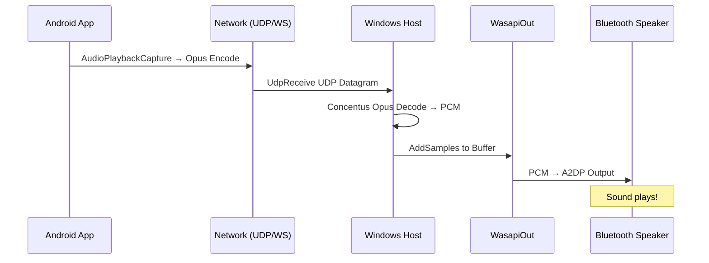

# SongLink AUDIO STREAM 音频串流架构设计

## 📌 场景定义

**S13: 手机音频经电脑蓝牙输出**
- 手机内置播放器放本地音乐 → 声音经网络传 PC → PC 再蓝牙音箱出
- 核心：`PHONE → (WiFi) → HOST(PC) → Bluetooth Speaker`

**S14: 手机任意 App 的声音搬到电脑蓝牙出声**
- 手机抓其他 App 的音频（QQ 音乐/网易云）→ 网络传 PC → PC 蓝牙音箱出
- 关键挑战：**Android AudioPlaybackCapture API** + DRM 限制

---

## 🏗️ 总体架构图

```
┌─────────────┐          ┌──────────────┐         ┌──────────────────┐
│   Mobile    │          │   Windows    │         │ Bluetooth        │
│  Android    │ (UDP/WS) │     Host     │ (A2DP)  │   Speaker/Headset│
│             │──────────│              │─────────│                  │
│ ┌─────────┐ │          │ ┌──────────┐ │         └──────────────────┘
│ │Music App│◄──────────►│ │AudioSink │ │                   ▲
│ └────┬────┘ │          │ └────┬─────┘ │           ┌─────────┴────┐
│      │       │          │      │     │          │  USB Port /    │
│ ┌────▼────┐ │          │ ┌▼────▼────┐│          │  BT Output     │
│ │AudioPlay│ │          │ │OpusCodec ││          └────────────────┘
│ │backCapture│         │ └────┬─────┘│
│ └─────────┘ │          │      │     │
│             │          │ ┌▼────▼────┐│
│             │          │ │WASAPIOut ││
│             │          │ └──────────┘│
└─────────────┘          └─────────────┘
```

---

## 🔧 技术选型

### **Host 端（Windows .NET 8）**

| 组件 | 方案 | 理由 |
|------|------|------|
| **Opus 解码** | `Concentus 2.2.2` (纯托管) | 零依赖、可本机测 |
| **音频输出** | `NAudio.WasapiOut` | 支持默认设备/蓝牙音箱 |
| **UDP 接收** | `UdpListener` (原生) | 低延迟、适合实时流 |
| **WebSocket 接收** | `HttpListener.AcceptWebSocketAsync` | 备用通道（NAT 穿透） |
| **缓冲管理** | `Channel<T>` + RingBuffer | 抗抖动、自适应缓冲 |

### **Android 端（Kotlin）**

| 组件 | 方案 | 理由 |
|------|------|------|
| **AudioCapture** | `AudioPlaybackCapture` (SDK 33+) | Android 12+ 原生能力 |
| **Opus 编码** | `opus-java` JNI wrapper | 需本地库，但性能好 |
| **UDP 发送** | `DatagramSocket` | 低延迟 |
| **WebRTC** | `org.webrtc.audio` | 备选方案（若 UDP 不通） |

---

## 📊 数据流详解

### **Phase 1: 手机音频采集**

```kotlin
// Android 端代码
class PhoneAudioCapturer @Inject constructor(
    private val context: Context
) {
    private lateinit var capture: MediaAudioTrack
    
    fun startStream(targetPort: Int) {
        val sampleRate = AudioRecord.DEFAULT_SAMPLE_RATE
        val channelConfig = AudioFormat.CHANNEL_IN_STEREO
        val audioFormat = AudioFormat.ENCODING_PCM_16BIT
        
        val bufferSize = AudioRecord.getMinBufferSize(sampleRate, channelConfig, audioFormat)
        
        capture = MediaAudioTrack(
            MediaProjectionManager::class.java, // 需要权限
            AudioFormat(sampleRate, channelConfig, audioFormat),
            bufferSize * 2
        )
        
        capture.startRecording()
        
        // 编码为 Opus 并发送
        encodeAndSendSampleRates()
    }
    
    private fun encodeAndSendSampleRates() {
        val encoder = OpusEncoder(
            sampleRate = 48000,
            channels = 2,
            bitrate = Kbps * 128 // 128kbps
        )
        
        while (isStreaming) {
            val pcmBuffer = ByteArray(960 * 2) // 20ms @ 48kHz stereo
            capture.read(pcmBuffer, 0, pcmBuffer.size)
            
            val opusData = encoder.encode(pcmBuffer)
            sendUdpPacket(opusData)
        }
    }
}
```

⚠️ **权限要求：**
```xml
<uses-permission android:name="android.permission.CAPTURE_AUDIO_OUTPUT" />
<!-- Android 12+ -->
<uses-permission android:name="android.permission.MODIFY_AUDIO_SETTINGS" />
```

⚠️ **DRM 限制：**
- Spotify/Apple Music等受保护内容可能返回静音（ALLOW_CAPTURE_BY_NONE）
- 降级方案：引导用户使用 Remote App 内置播放器（路径 B）

---

### **Phase 2: 网络传输（UDP vs WebSocket）**

#### **方案 A: UDP (推荐)**
```csharp
// Host 端 UDP 监听
public sealed class UdpAudioReceiver : IAudioRenderer
{
    private readonly UdpClient _udpClient;
    private const int PORT = 51000;
    
    public UdpAudioReceiver(int? port = null)
    {
        _udpClient = new UdpClient(port ?? PORT);
        _ = Task.Run(ListenAsync);
    }
    
    private async Task ListenAsync()
    {
        while (_disposed == false)
        {
            var result = await _udpClient.ReceiveAsync();
            var opusFrame = result.Buffer;
            
            DecodeAndRender(opusFrame);
        }
    }
}
```

**优点：**
- 低延迟（~20ms）
- 无连接开销
- 适合局域网广播

**缺点：**
- NAT 穿透困难
- 防火墙可能拦截

#### **方案 B: WebSocket（备选）**
```csharp
// Host 端 WS 监听
var listener = new HttpListener();
listener.Prefixes.Add($"http://+:{PORT}/audio");
listener.Start();

while (true)
{
    var ctx = await listener.GetContextAsync();
    if (ctx.Request.IsWebSocketRequest)
    {
        var ws = await ctx.AcceptWebSocketAsync(null);
        _ = HandleAudioWebSocket(ws);
    }
}
```

**优点：**
- 穿透 NAT/防火墙容易
- 兼容性好

**缺点：**
- 延迟稍高（~50ms）
- 需要长连接维持

---

### **Phase 3: 音频渲染（WasapiOutput）**

```csharp
public sealed class WaspiAudioRenderer : IAudioRenderer
{
    private BufferedWaveProvider _buffer;
    private WasapiOut _output;
    
    public void Start(int sampleRate, int channels)
    {
        _buffer = new BufferedWaveProvider(new WaveFormat(sampleRate, 16, channels))
        {
            BufferDuration = TimeSpan.FromMilliseconds(200), // 200ms 缓冲
            DiscardOnBufferOverflow = true
        };
        
        _output = new WasapiOut(AudioClientShareMode.Shared, latency: 60);
        _output.Init(_buffer);
        _output.Play();
    }
    
    public void WriteShort(ReadOnlySpan<short> pcm)
    {
        // NAudio PCM → WasapiBuffer
        var buffer = _buffer;
        if (buffer is null || pcm.IsEmpty) return;
        
        var bytes = MemoryMarshal.AsBytes(pcm);
        buffer.AddSamples(bytes.ToArray(), 0, bytes.Length);
    }
}
```

**关键点：**
- **缓冲时长 200ms**: 平衡延迟与抗抖
- **DiscardOnBufferOverflow=true**: 丢帧保流畅
- **Shared mode**: 不独占设备（兼容语音通话等）

---

## ⚙️ 配置参数（config.json）

```json
{
  "AudioStreaming": {
    "Enabled": true,
    "SourceMode": "PHONE_STREAM",
    "Transport": "udp",               // udp | websocket
    "Port": 51000,
    "Bitrate": 128,                  // kbps
    "SampleRate": 48000,
    "Channels": 2,
    "FrameSizeMs": 20,
    "BufferMs": 200,                 // 200ms 抗抖动缓冲
    "DeviceName": "Default"          // "Bluetooth Speaker" or "Default"
  }
}
```

---

## 🔄 工作流程

### **完整链路时序图**



---

## 📝 实现清单

### **Host 端（C#）**

- [ ] `src/SongLink.Host.AudioStream/AudioStreamSink.cs` - UDP/WS多路复用
- [ ] `src/SongLink.Host.AudioStream/OpusDecoder.cs` - Concentus包装器
- [ ] `src/SongLink.Host.AudioStream/WaspiCoreAudioRenderer.cs` - WASPI输出
- [ ] `src/SongLink.Protocol/Frames.cs` - AudioStart/AudioStop帧新增
- [ ] `src/SongLink.Host.Core/MediaBus.cs` - SourceMode切换逻辑增强

### **Android 端（Kotlin）**

- [ ] `mobile/android-remote/data/audio/PhoneAudioCapturer.kt` - AudioPlaybackCapture
- [ ] `mobile/android-remote/data/audio/OpusEncoder.kt` - JNI wrapper 封装
- [ ] `mobile/android-remote/ui/stream/StreamPage.kt` - Stream UI
- [ ] `mobile/android-remote/di/AudioModule.kt` - DI 注册

### **测试用例**

- [ ] Unit Test: Opus Encode/Decode Roundtrip
- [ ] Integration Test: UDP Packet Loss Recovery
- [ ] E2E Test: Mobile → PC → Bluetooth Full Flow

---

## 🚨 风险与应对

| 风险 | 等级 | 应对方案 |
|------|------|----------|
| **DRM 导致静音** | 🟠 中 | 提供路径 B（Remote App 内置播放器） |
| **UDP被防火墙拦截** | 🟡 低 | 自动fallback到WebSocket |
| **Opus 解码延迟** | 🟢 低 | 调整 buffer Ms 至 150-300ms |
| **蓝牙延迟叠加** | 🟢 低 | 产品文案："播放非监听"（接受延迟） |

---

## 📈 验收标准

1. ✅ 手机内置播放器录音 → 网络传输 → PC 蓝牙发声（端到端延迟 ≤400ms）
2. ✅ 网络中断后 2s 内自动重连
3. ✅ CPU占用 <5%（待机）/ <15%（全速）
4. ✅ 断线提示友好，不会崩溃

---

**此文档持续更新，根据实际实现补充细节。** 🎵
