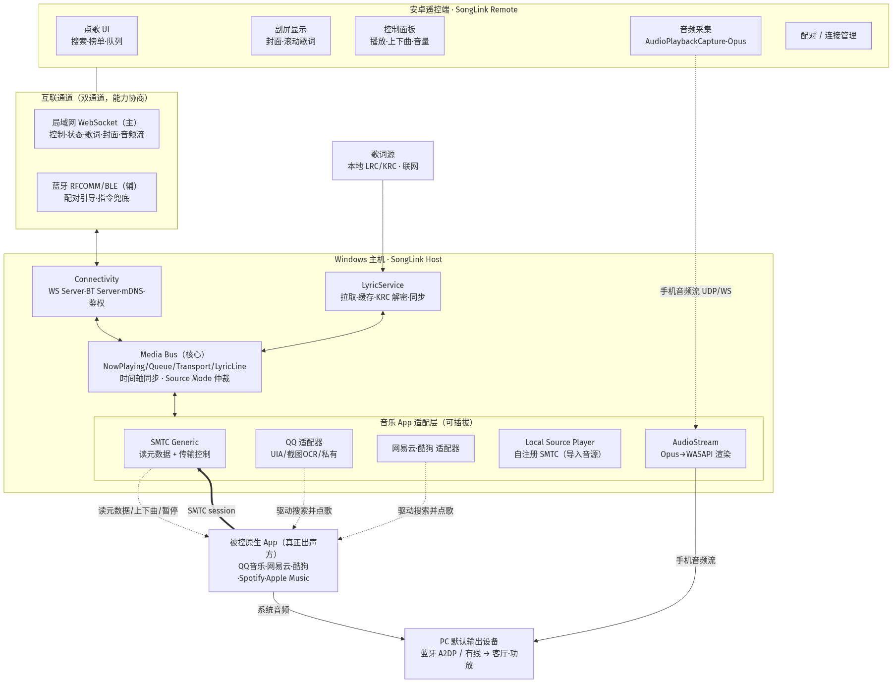
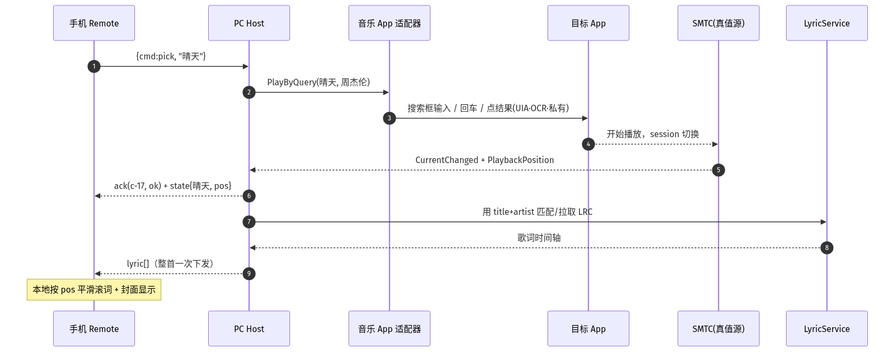
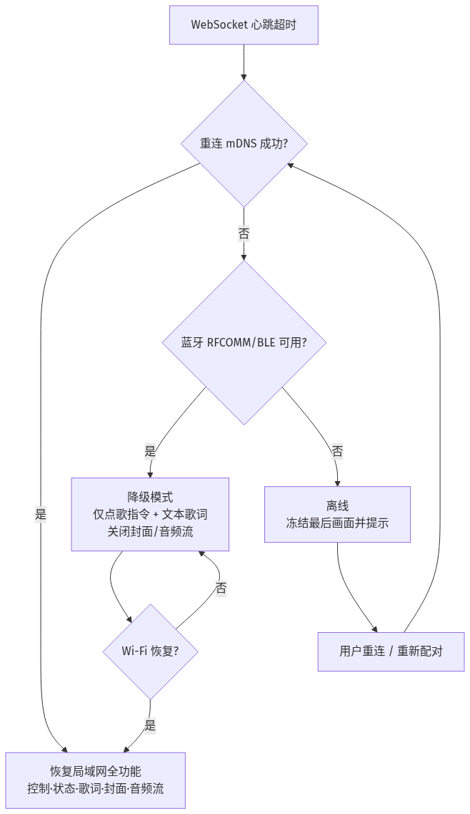
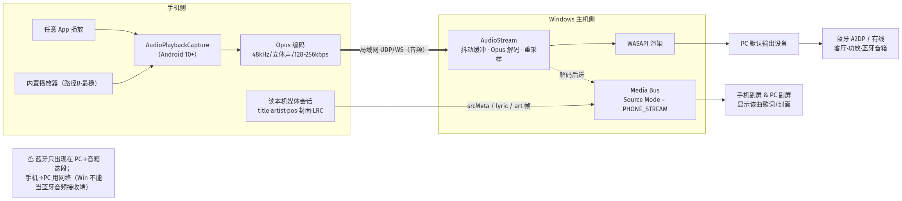
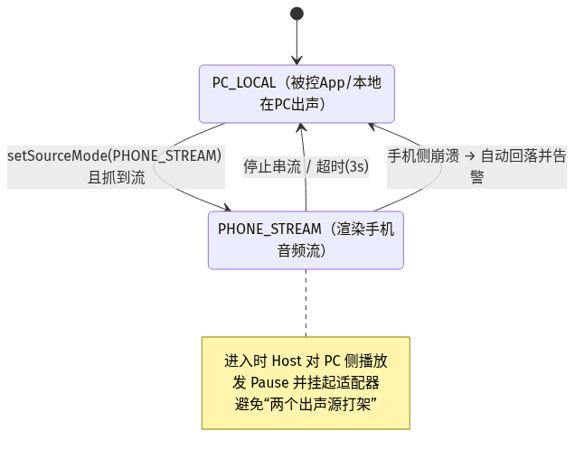

# 电脑-安卓互联点歌台面板 · 技术方案与架构设计

- 项目代号：**SongLink（点歌台）**
- 版本：v0.1（立项架构稿）
- 日期：2026-10-03
- 状态：待评审

---

## 0. 立项决策摘要（已确认）

| 决策项 | 选定方案 | 说明 |
|---|---|---|
| 主控/显示端 | **Windows 主机** | PC 负责播放、被控音乐 App、歌词/专辑图处理、对外服务 |
| 安卓设备角色 | **遥控端 + 副屏** | 手机/平板做点歌遥控器，并实时显示当前曲目的歌词与封面 |
| 播放内核 | **直接操控原生音乐 App** | QQ音乐 / 网易云 / 酷狗 等已装客户端为真正出声方 |
| 互联通道 | **局域网为主 + 蓝牙为辅（双通道）** | 局域网（Wi-Fi）走主控制与富数据；蓝牙做配对引导与点歌指令兜底 |
| 音源 | **原生 App 为主，本地导入音源为兜底/扩展** | 见 §4.6，本地音源以"自注册 SMTC 播放器"形式统一接入 |
| **手机音频输出** | **手机音频经网络串流进 PC，由 PC 蓝牙/音箱出声** | 新增能力（§3.7/§14）；Windows 不能当蓝牙音频接收端，故音频用网络进 PC、蓝牙只做 PC→音箱输出 |
| 本次交付 | **技术方案 + 架构文档** | 不含实现代码 |

> ⚠️ 一个必须先讲清楚的结论：**"直接操控第三方原生音乐 App" 是本方案技术风险最高的一环**。这些 App 均无公开的"外部点歌/取词"API，只能用 Windows 系统级能力（SMTC）+ UI 自动化 + 本地协议探测组合逼近。架构上我们用**适配层（Adapter）+ 统一媒体总线**把不确定性隔离开，并保留**本地音源自建播放**作为永远可用的兜底，保证产品"永远能点、永远能显示"。详见 §4 与 §9。

---

## 1. 项目概述与目标

构建一套面向家庭 / 小型聚会 KTV 场景的"点歌台"系统：**Windows 电脑**是点歌与播放中枢，**安卓手机/平板**充当无线点歌遥控器和歌词副屏。用户像点歌机一样在手机搜索、点歌、切歌、调音量；PC 端把指令翻译成对某个主流音乐 App 的真实操作并播放，再把当前歌曲、进度、歌词、封面回传到手机显示。支持手机与 PC 之间通过局域网或蓝牙配对互联，支持导入本地音源作为补充曲库与兜底播放。

### 1.1 核心用户故事

- 作为客人，我在手机点歌界面搜"晴天"，点一下，客厅音箱里的 QQ音乐就开始放，我的手机屏幕上同步滚动歌词并显示封面。
- 作为主持，我在点歌队列里把某首移到最前 / 删除 / 顶歌。
- 作为用户，我把一首下载好的 MP3/KRC 拖进点歌台，也能被点播放并显示我导入的歌词。
- 作为用户，我家 Wi-Fi 一般，我用蓝牙把手机和电脑配对后依然能点歌（歌词/封面走"点歌后自动尝试局域网"或降级为纯文本）。

### 1.2 非目标（本期不做）

- 不做自带曲库的在线音乐服务（不代理/转存任何平台的受版权内容）。
- 不做多点歌台组网、跨房间同步（后续可扩）。
- 不做 iOS 端（本期安卓优先）。
- 不做人声分离/原唱伴奏切换（依赖被控 App 自身能力）。

---

## 2. 术语与角色

| 术语 | 含义 |
|---|---|
| **SongLink Host** | Windows 端常驻中控程序（托盘应用），系统的大脑 |
| **SongLink Remote** | 安卓遥控端 App（点歌 UI + 副屏显示） |
| **Target Player** | 被操控的原生音乐 App（QQ音乐/网易云/酷狗/Spotify/Apple Music…） |
| **SMTC** | Windows System Media Transport Controls，系统级"正在播放"会话接口，可读元数据+发传输控制指令 |
| **Adapter（适配器）** | 针对某个 Target Player 的具体控制实现，屏蔽 App 差异 |
| **Media Bus（媒体总线）** | Host 内部统一的事件/状态模型，所有来源都归一后再对外发布 |
| **Controller Channel** | Remote↔Host 的控制与状态通道（局域网 WebSocket 或蓝牙 RFCOMM/BLE） |
| **KRC / LRC** | 带时间轴的歌词文件；KRC 为 QQ系加密歌词格式，LRC 为通用明文 |

---

## 3. 关键技术与可行性边界（决定架构的地方）

在写架构前，先固化"能做到 / 勉强能 / 做不到"的判断，架构就是围绕这些约束设计的。

### 3.1 读取"正在播放"的曲目/封面/进度 —— ✅ 可靠

Windows 提供 **SMTC**（`Windows.Media.Playback.GlobalSystemMediaTransportControlsSessionManager`）。绝大多数现代音乐客户端（含 QQ音乐/网易云新版、Spotify、Apple Music for Windows）会把当前播放注册为一个 SMTC session，可读：

- `MusicProperties`：Title / Artist / Album / Genre
- `PlaybackInfo`：播放状态（Playing/Paused/Stopped）、`PlaybackPosition`（进度）
- `ThumbnailProperties`：专辑封面（随机访问流，可直接取图）

这是**跨 App 统一**的只读/传输控制入口，是整台系统的"当前曲目真值来源"。Host 用 .NET/C++ 访问最稳（WinRT API）。

### 3.2 发传输控制（播放/暂停/上一首/下一首） —— ✅ 可靠

- SMTC `TransportControls`：`Play/Pause/Next/Previous/Stop` 直接调用，跨 App 通用。
- 兜底：`SendMessage(WM_APPCOMMAND)` 或全局媒体键虚拟键码（VK_MEDIA_NEXT_TRACK 等）广播。

### 3.3 "点歌任意指定歌曲"（搜索并播放某首） —— ⚠️ 最难，需逐 App 适配

SMTC **不提供**"播放指定歌曲/搜索"能力，只能对"当前队列"做传输控制。要实现"手机点哪首 PC 就放哪首"，只能靠下面几条路径按 App 择优组合：

1. **App 自带远程点歌协议**（最优，若存在）：如 QQ音乐生态里的"远程点歌/我的设备"，网易云"设备投送"。多为私有/需登录，逆向成本高、易失效。列为可选增强，不作为地基。
2. **UI 自动化（UIA / SendInput）**：驱动 App 的搜索框输入歌名 → 回车 → 点击结果第一行。国产 App 多为 CEF/Electron 套壳，UIA 对网页内容暴露差，往往退化成"截图 OCR + 坐标模拟点击"，脆弱且依赖窗口尺寸/DPI/版本。
3. **本地 HTTP/命名管道协议探测**：部分客户端开放本地端口（多为加密私有协议），性价比低。
4. **播放列表投喂**：把目标曲目落到 App 的本地播放列表/收藏，再用 SMTC 队列导航。

> **架构结论**：点歌必须走 **Adapter 抽象**。Host 不假设"点歌=一个通用调用"，而是为每个受支持 App 写一个 `IPlayerAdapter`，内部自选上面 1–4 手段。没有专属适配器的 App 自动降级为"仅传输控制 + 本地音源播放"。

### 3.4 歌词 —— ⚠️ 不来自被控 App，改为自建歌词服务

SMTC **不含歌词**。从被控 App 的歌词窗口抠字（UIA/OCR）极不稳。务实方案：**自建歌词子系统**——

- 以 SMTC 给的 `Title + Artist (+ Album/时长)` 为键，去歌词源拉取带时间轴的 LRC（如公共 API `lrclib.net`、网易云公开 lyric 接口等，具体来源上线前按合规确认）。
- 用 SMTC 的 `PlaybackPosition` 做**位置同步**，本地滑动时间轴滚词。
- 用户导入的 LRC/KRC 优先于联网拉取。

好处：歌词显示与"被控 App 是哪家"彻底解耦，跨 App 一致、可离线、可自定义排版。

### 3.5 蓝牙点歌 —— ✅ 可行,蓝牙做"指令通道 + 配对引导",不做"手机→PC 的音频链路"

要先区分**两段不同的链路**,原文"不通过蓝牙传音频"特指第一段:

- **PC → 蓝牙音箱/耳机(输出段)**:这是 Windows 最常规的用法——PC 作 **A2DP Source**,把声音播给配对的蓝牙音箱。**完全可靠,天然支持**,§3.7 的"手机音频经电脑蓝牙输出"就是复用这一段。
- **手机 → PC(输入段)**:想靠手机作 A2DP Source、PC 作 **A2DP Sink** 接收手机音频——**Windows 对"接收蓝牙音频"支持极差**(基本不是出厂能力,驱动/协议栈缺失)。所以手机音频**不走蓝牙进 PC**,而是走**网络串流(Wi-Fi/USB)进 PC,再由 PC 从蓝牙音箱出声**。见 §3.7。
- **点歌指令 / 配对引导**:蓝牙 **RFCOMM(SPP)/BLE GATT** 足以传点歌指令、文本状态与首次配对时交换局域网地址(吞吐小、延迟可接受)。富数据(封面、歌词批量、队列、音频)始终优先局域网。
- 手机与 PC 需在物理范围(<10m)内且首次配对时开启蓝牙,之后可断蓝牙只用 Wi-Fi。

### 3.6 本地导入音源 —— ✅ 完全可控

自己播放 MP3/FLAC 无障碍，关键是**如何让手机副屏像对第三方 App 一样显示它**：Host 内置一个极小的播放内核（如 BASS_Un4seen / NAudio / WMF），**主动注册自己的 SMTC session（`IsPlaySiteEnabled`、DisplayUpdates）**，于是走的是与"读第三方 App"完全相同的 Media Bus 管线。这是让系统"永远能放"的兜底，也让架构统一。

### 3.7 手机音频串流到电脑输出 —— ✅ 可行(需新增"音源模式"),关键在 Android 抓音频

新需求:**手机在放歌(可能是手机上任意音乐 App),声音要经电脑、并从电脑连接的蓝牙音箱/功放出声**。端到端链路 = `手机音频 → (网络) → PC 解码 → PC 默认输出设备(可为蓝牙音箱)`。音频进 PC 用**网络**(Wi-Fi/USB),PC 出声音用 PC 自己配对的**蓝牙**——避开了 §3.5 里 Windows 当不了蓝牙音频接收端的坑。

**核心使能与难点是"怎么把手机正在放的声音抓出来"**:

- **路径 A|抓取其他 App 的声音(通用)**:Android 10+ 提供 **`AudioPlaybackCapture`** API,App 经用户授权(`MediaProjection`/capture permission)可捕获本机其他应用播放的媒体音频,再编码外送。**这是让"手机任意 App 的声音搬到电脑放"成立的关键**。限制:部分 App/内容若设了 `ALLOW_CAPTURE_BY_NONE` 或受 DRM 保护则抓不到(版权内容可能静音),需在产品里明确告知。
- **路径 B|手机自己当播放源(最稳)**:由 SongLink Remote 内置播放器放本地/导入音源,音频本就是自己的,无抓取限制、无 DRM 问题,链路最干净。
- **传输与编码**:抓到的 PCM 用 **Opus**(低码率高音质)编码,走局域网 UDP/WebSocket 分帧上送;PC 端解码后写入 `_wasapi`/默认渲染设备。带宽 48kHz 立体声约 128–256 kbps,Wi-Fi 毫无压力。
- **延迟**:网络缓冲 ~60–150ms + PC→蓝牙(SBC ~150–250ms,aptX/LC3 更低)。听歌/K 歌可接受;**不适合需要零延迟监听的场景**(如手机麦克风直返)。文案按"播放"而非"监听"定位。
- **音源模式切换(架构新增)**:Host 的 Media Bus 增加 **Source Mode** 概念——`PC_LOCAL`(§3.6 本地/被控 App 在 PC 出声)与 `PHONE_STREAM`(手机音频流进 PC 再出)。二者互斥、一键切换;`PHONE_STREAM` 时 PC 不主动操控第三方 App(避免抢声),PC 只负责渲染手机流并回推歌词/封面。
- **歌词/封面在串流模式怎么来**:手机是出声方,元数据也在手机上,所以 `PHONE_STREAM` 模式下**元数据/歌词/封面由手机侧上报**(手机读自己正在放 App 的媒体会话或用户导入的 LRC),经协议帧回传给 PC/副屏,与 §3.4 自建歌词逻辑对齐,只是数据方向反过来。

---

## 4. 总体架构

### 4.1 分层与组件视图



> 图源(可编辑)`diagrams/architecture.mmd` · 矢量高清`diagrams/architecture.svg`


### 4.2 设计原则

1. **SMTC 是真值锚点**：任何"当前在放什么/放到哪"以 SMTC 为准，杜绝各 App 各自为政导致副屏与音箱不同步。
2. **Adapter 隔离不确定性**：第三方 App 的可控性差异全部封装在适配器里；新增一个 App = 新增一个适配器，不动主干。
3. **歌词/封面自建、与出声方解耦**：换 App 不影响副屏体验。
4. **双通道不对等**：局域网=完整体验（含图/词/队列）；蓝牙=指令子集 + 配对引导。协议按通道能力自动降级。
5. **永远有兜底**：本地音源播放器自注册 SMTC，保证在最坏情况（无可用第三方适配器 / 无网）下"能点、能放、能显示"。
6. **手机端零业务逻辑**：Remote 只做"发指令 + 渲染 Host 推来的状态"，重逻辑全在 Host，便于快速迭代、手机端保持薄。

---

## 5. 技术选型

| 层 | 选型 | 理由 / 备选 |
|---|---|---|
| **PC Host 语言** | **C# / .NET 8** | 访问 WinRT SMTC、UIA、串口、`System.Net.WebSockets` 最顺；桌面生态成熟。备选 C++/WinRT（性能极致但开发慢） |
| **PC Host 形态** | 托盘常驻 WPF/WinUI3（无主窗口，系统托盘 + 设置窗） | 后台服务化；Kestrel 或裸 HttpListener 承载 WebSocket |
| **PC WebSocket** | `System.Net.WebSockets` + Kestrel（ASP.NET Core 最小宿主） | mDNS 用 `Zeroconf` NuGet |
| **PC 蓝牙** | `InTheHand.Net.Bluetooth`(32feet.NET) 做 RFCOMM；WinRT `BluetoothLEDevice` 做 GATT | 桌面蓝牙栈支持较杂，见风险 §9 |
| **本地播放内核** | NAudio 或 BASS_Un4seen | BASS 解码格式全；NAudio 纯托管易维护 |
| **UI 自动化** | `FlaUI` / `UIAutomationClient` + SendInput 兜底 | CEF 套壳需退到截图+模板匹配/OCR |
| **OCR（点歌兜底/抠词）** | Windows `Media.Ocr`（内置，离线，免费） | 备选 Paddle/Tesseract |
| **歌词同步** | Host 内时间轴引擎，按 SMTC position 驱动 | 见 §6.4 |
| **安卓语言/UI** | **Kotlin + Jetpack Compose** | 声明式 UI 适合实时刷新歌词/封面 |
| **安卓网络** | OkHttp WebSocket | |
| **安卓蓝牙** | `BluetoothAdapter` + `BluetoothSocket(RFCOMM)` / `BluetoothGatt` | |
| **安卓图片** | Coil（加载 Host 推的封面流） | |
| **安卓歌词渲染** | 自研时间轴滚词 Composable | |
| **协议** | JSON 文本帧 + 版本/类型字段；二进制仅封面（分块或 HTTP 拉取） | 见 §6.5 |
| **发现/配对** | mDNS 广播 `_songlink._tcp` + 配对码(PIN)/二维码；蓝牙作为带外交换 LAN 地址 | 见 §6.6 |

---

## 6. 子系统设计

### 6.1 音乐 App 适配层（Adapter Layer）

统一接口（伪代码，C#）：

```csharp
interface IPlayerAdapter {
    string AppId { get; }                       // "qqmusic" | "neteasemusic" | ...
    bool    IsAvailable();                      // 进程/窗口是否存在
    AdapterCapability Caps { get; }             // 支持哪些操作(供上层降级)
    NowPlaying ReadNowPlaying();                // 基本都委托 SMTC
    void      Play(); void Pause(); void Next(); void Prev(); void SetVolume(int);
    Task<SearchResult[]> Search(string kw);     // 可能不支持→返回空
    Task<bool>    PlayByQuery(string song, string artist); // 点歌核心,最难
    Task<bool>    QueueAdd(TrackRef t);         // 投喂队列
}
```

三个内置适配器实现梯队：

1. **SmtcGenericAdapter（默认，人人可用）**：只读 SMTC 元数据 + 传输控制。`Caps.CanPickSong=false`。任何注册了 SMTC 的 App 都能被"读+播/停/上下曲+音量"，但**不能主动点任意歌**。
2. **PerAppAdapter（QQ/网易云/酷狗各一）**：在 Smtc 基础上叠加 `PlayByQuery`——优先私有远程点歌（若有），否则 UIA 驱动搜索框→回车→点结果；CEF 场景退化为截图+OCR+坐标点击。每个适配器独立测试、独立失效、互不影响。
3. **LocalSourceAdapter（本地音源）**：驱动内置播放内核，自注册 SMTC。`Caps` 全开。

**Adapter 路由器**：Host 按"当前 SMTC session 的 AppFamilyName/进程名"选择匹配的适配器；无专属适配器就落到 `SmtcGeneric`。用户也可在设置里"指定主控 App"。

**能力探测与自检**：安装时跑一遍各 App 能力探针（能否读元数据、能否上下曲、能否点歌），把结论存表；点歌时按 `Caps` 决定走"真点歌"还是提示"请用 App 内搜索后我来同步显示"。

### 6.2 点歌工作流（端到端）

```
手机输入关键词
  → Remote 发 {cmd:search, kw}
  → Host 路由:  有专属 Adapter 且 CanSearch → 返回 App 内搜索结果
                 否则 → 查本地曲库/联网歌名库(仅元数据,不含播放源) 供选择
  → 用户点某首 → Remote 发 {cmd:pick, track}
  → Host:
       if LocalSource 或 App 不支持点歌 且 已导入该音源 → LocalSourceAdapter.Play()
       else PerAppAdapter.PlayByQuery()  (UIA/私有协议)
             成功 → 等 SMTC session 切换确认(标题命中即认为成功)
             失败 → 回 {error, hint} 给手机 + 提示兜底
  → 加入排队队列(支持多人点歌/顶歌/删除), 队列尾自动 PlayNext
```

排队策略：FIFO + 手动置顶；Host 维护 `Queue`，SMTC 队列导航/逐首 `PlayByQuery` 串行执行，避免同时打断出声方。

### 6.3 媒体总线与状态同步

- Host 内部对 SMTC 事件订阅 `CurrentChanged` / `PropertyChanged`（PlaybackStatus、Position 定时采样 ~4Hz）。
- 归一为 `NowPlaying`（曲名/艺人/专辑/时长/状态/位置）事件，向所有已连 Remote 广播。
- 位置用"服务端时间戳 + 采样值 + 增量插值"，手机本地按墙钟平滑推进，减少抖动与流量。

### 6.4 歌词子系统

1. 触发：`NowPlaying` 变化 → 用 `Title+Artist+Duration` 匹配。
2. 来源优先级：**用户导入 LRC/KRC** > 本地歌词缓存目录 > 联网歌词源（KRC 先解密为 LRC）。
3. 同步：歌词时间轴对齐到 SMTC position；支持毫秒手动校正（不同 App 起播偏差不同）。
4. 下发：Host 把整首 LRC 一次性推给手机（小体积），手机本地滚词；换曲才重推，省流量、蓝牙也能带文本歌词。
5. 兜底：拿不到歌词 → 副屏只显示封面 + 静态信息，不报错。

### 6.5 通信协议

统一 JSON 帧（局域网/蓝牙共用，蓝牙按能力裁剪）：

```jsonc
{ "v":1, "type":"hello",    "role":"remote", "device":"Pixel-7", "caps":["lyric","art"] }
{ "v":1, "type":"cmd",  "id":"c-17", "action":"pick",     "args":{"title":"晴天","artist":"周杰伦"} }
{ "v":1, "type":"cmd",  "id":"c-18", "action":"next" }
{ "v":1, "type":"state",     "now":{"title":"晴天","artist":"周杰伦","pos":12.3,"dur":269,"status":"playing"} }
{ "v":1, "type":"lyric",     "trackId":"a:晴天-周杰伦","lines":[{"t":0,"x":"..."}] }
{ "v":1, "type":"art",  "ref":"img:xxx" }   // 大图经 HTTP GET /art/xxx 拉取,不走帧内
{ "v":1, "type":"ack",  "ref":"c-17", "ok":true }
{ "v":1, "type":"event",     "name":"queue-updated","queue":[ ... ] }
{ "v":1, "type":"error", "ref":"c-18","code":"PICK_UNSUPPORTED","hint":"请用 App 搜索后自动同步" }
```

- 大对象（封面）走 `ref` + 局域网 HTTP，避免撑爆蓝牙帧。
- 通道能力协商：`hello.caps` 决定 Host 是否推 `art`（蓝牙模式默认关图，保留词/文本）。
- 幂等：`cmd.id` + `ack.ref`；断线重连后手机带 `lastSeq` 补状态。

### 6.6 连接、发现与配对（双通道）

**首选（局域网）**：Host 用 mDNS 广播 `_songlink._tcp._local`；手机自动列出在线主机 → 首次连接弹 **4–6 位 PIN**（PC 托盘显示）→ 手机输入配对 → 得到长期 token（存本地）。

**配对引导 / 无 Wi-Fi 兜底（蓝牙）**：手机扫描 → Host 蓝牙 BLE GATT 暴露配对特征 → 手机通过蓝牙接收 LAN 地址与 PIN（带外交换）→ 自动切到 WebSocket；若始终无 LAN，则保留蓝牙 RFCOMM 作为纯指令通道（点歌/上下曲/播放暂停/文本歌词），关闭封面图。

**鉴权**：token + 每帧 HMAC（简单防局域网内冒烟）。

### 6.7 安卓遥控端

- 页面：连接/配对页、点歌主页（搜索框+结果+我的队列）、副屏页（全屏封面+滚动歌词，可投到第二块屏）、控制面板（播放/暂停/上下曲/音量）、设置。
- 渲染：Compose 列表 + 自定义滚词组件；Coil 拉封面。
- 与 Host 断连时本地缓存最后一帧状态 + 明确离线态。

---

## 7. 关键数据流（时序）

### 7.1 一次"手机点歌"



> 图源(可编辑)`diagrams/点歌时序.mmd` · 矢量高清`diagrams/点歌时序.svg`


### 7.2 断线/降级



> 图源(可编辑)`diagrams/断线降级.mmd` · 矢量`diagrams/断线降级.svg`


---

## 8. 模块划分与目录结构（建议）

```
SongLink/
├─ host/                         # .NET 8 托盘中控
│  ├─ SongLink.Host/            # 入口/托盘/生命周期
│  ├─ SongLink.MediaBus/        # 状态机/事件/时间轴同步
│  ├─ SongLink.Smtc/            # SMTC 读取+传输控制封装
│  ├─ SongLink.Adapters/        # IPlayerAdapter + QQ/NetEase/Kugou/SmtcGeneric/LocalSource
│  ├─ SongLink.Lyrics/          # 歌词拉取/缓存/KRC 解密/同步
│  ├─ SongLink.Connectivity/    # WebSocket Server + 蓝牙 + mDNS + 配对鉴权
│  ├─ SongLink.Player/          # 内置本地播放内核(NAudio/BASS)+ 自注册 SMTC
│  ├─ SongLink.AudioStream/     # 手机音频接收: Opus 解码→WASAPI 渲染(写默认/蓝牙输出设备)
│  ├─ SongLink.SourceMode/      # 音源模式仲裁: PC_LOCAL ↔ PHONE_STREAM(互斥/切换/冻结)
│  └─ SongLink.Protocol/        # 帧定义/序列化(与 Remote 共享契约)
├─ remote/                       # Android (Kotlin + Compose)
│  ├─ app/
│  │  ├─ data/transport/        # WS + Bluetooth 客户端 / 通道协商
│  │  ├─ data/audio/            # AudioPlaybackCapture 采集 + Opus 编码 + 上送 / 本机播放会话读取
│  │  ├─ data/repo/             # 状态/歌词/封面仓库
│  │  ├─ ui/pair  ui/pick  ui/screen  ui/control
│  │  └─ protocol/             # 与 Host 对齐的帧模型
│  └─ shared-contract/          # 从 host/Protocol 生成的 schema
├─ docs/                         # 本方案/接口契约/适配器开发指南
└─ tools/                        # 能力探针脚本/契约测试/回放器
```

---

## 9. 风险登记册与应对

| # | 风险 | 等级 | 影响 | 应对 |
|---|---|---|---|---|
| R1 | 第三方 App **无公开点歌 API**，UIA/坐标点击随版本/DPI/主题失效 | 🔴 高 | "点任意歌"不稳定 | 专属适配器 + 能力探针 + 版本看门狗；失败明确降级为"仅传输控制"或本地音源；把易变的点击逻辑做成可热更脚本 |
| R2 | 国产 App 多为 **CEF/Electron 套壳**，UIA 读不到内容 | 🔴 高 | 搜索/选结果难 | 截图 + Windows OCR + 模板匹配；或引导用户用私有远程点歌（若有） |
| R3 | 部分 App/版本 **不注册 SMTC** 或元数据缺字段 | 🟠 中 | 读不到当前曲/进度 | 多信号融合（SMTC→进程窗口标题解析→OCR）；文档化受支持 App 白名单 |
| R4 | **歌词来源合规性**（联网拉取受版权 LRC） | 🟠 中 | 法律/稳定性 | 优先用户导入 + 本地缓存；联网源可插拔、可关；上线前法务确认 |
| R5 | **桌面蓝牙栈支持杂**（Windows 蓝牙驱动/RFcomm 权限/BLE 中心-外围角色） | 🟠 中 | 蓝牙通道不稳 | 蓝牙定位为"引导+兜底"非主干；M0 先做 spike 验证目标机型；RFCOMM 需配对/服务 GUID，BLE GATT 作 Plan B |
| R6 | 蓝牙 A2DP **接收端** Windows 不支持(手机音频不能靠蓝牙灌进 PC) | 🟠 中 | 串流链路选型 | 手机音频走**网络**进 PC,PC 再用自身蓝牙**输出**(§3.5/§3.7);绝不规划 Windows-as-A2DP-sink |
| R7 | SMTC 采样位置有**延迟/抖动**，歌词与声音不齐 | 🟡 低 | 歌词偏移 | 插值 + 每 App 全局 offset 校准 + 用户毫秒微调 |
| R8 | 多人同时点歌**互相打断**出声方 | 🟡 低 | 队列混乱 | Host 串行队列 + 置顶/锁定；点歌需 ack 才计入 |
| R9 | **反自动化/风控**（若用私有协议/抓包）导致封号 | 🟠 中 | 账号风险 | 私有协议为可选增强、默认关闭；主打系统级 SMTC + 本地音源，不碰账号侧写接口 |
| R10 | **AudioPlaybackCapture 抓不到受保护内容**(DRM/App 设 `ALLOW_CAPTURE_BY_NONE`) | 🟠 中 | 串流静音,某些 App 无输出 | 产品明示"受版权内容可能无法串流";提供路径 B(手机内置播放器)作可靠替代;引导用可抓的 App |
| R11 | **手机音频串流端到端延迟**(网络+蓝牙叠加 ~200–400ms) | 🟡 低 | 不适合零延迟监听 | 定位为"播放"非"监听";SBC 可换 aptX/LC3;动态缓冲调优 |
| R12 | 串流模式下**音频焦点/抢占**与 PC 本地播放互打 | 🟡 低 | 抢声/卡顿 | Source Mode 严格互斥;`PHONE_STREAM` 时 Host 冻结本地/被控 App 播放 |

---

## 10. 里程碑与交付计划

| 里程碑 | 目标 | 关键产出 | 出口判据 |
|---|---|---|---|
| **M0 · 可行性 Spike（1–1.5 周）** | 打掉 R1/R3/R5/R10 不确定性 | ① .NET 读某 App SMTC 元数据+封面+上下曲；② UIA/OCR 成功点歌 1 首；③ 手机蓝牙 RFCOMM 发一条指令 PC 收到；④ Android `AudioPlaybackCapture` 在目标机型抓到目标 App 音频→Opus 串流→PC 从(蓝牙)音箱出声 | 在**目标 App 具体版本 + 目标机型**上四条各跑通；据此定适配器与串流优先级 |
| **M1 · 最小闭环 MVP（3–4 周）** | 局域网端到端能用 | Host(托盘)+WS+SMTC Generic+本地音源播放器；Remote 连接+副屏(封面/歌词)+播放/上下曲 | 手机点本地音源→PC 出声→副屏同步歌词封面，断连可重连 |
| **M2 · 点歌与队列（3–4 周）** | 真点歌 + 多人排队 | 1–2 个专属 App 适配器(PlayByQuery)、队列/顶歌/删除、能力探针与降级、自建歌词拉取 | 在主流 App 上稳定点歌≥目标机型 90% 场景 |
| **M2.5 · 手机音频串流（2–3 周）** | Source Mode=`PHONE_STREAM` 落地 | AudioPlaybackCapture 采集+Opus 串流+PC 解码写默认输出(含蓝牙);手机侧元数据/歌词/封面回传;与本地播放互斥切换 | 手机任意可抓 App 放歌→声音经 PC 蓝牙音箱出→副屏显示手机上报的歌词/封面 |
| **M3 · 蓝牙双通道（2–3 周）** | 配对引导 + 指令兜底 | 蓝牙带外交换 LAN/PIN、BLE/RFCOMM 指令通道、按 caps 降级 | 无 Wi-Fi 场景可用蓝牙完成点歌(文本歌词) |
| **M4 · 打磨与扩展（持续）** | 好用 + 多 App | 更多适配器、音量/音效、副屏主题、KRC 导入、看门狗自动修适配 | 崩溃率/点歌成功率达标 |

---

## 11. 可行性结论与务实建议

**能做，但"稳定点任意歌"取决于目标 App 的具体版本，必须用 M0 spike 先验证、再定实现优先级。** 建议的产品地基排序：

1. **以 SMTC 为统一真值源**（读当前曲/进度/封面 + 传输控制）——这部分**跨 App 稳定、风险低**，是副屏体验的可靠底座，应最先落地。
2. **本地导入音源用自注册 SMTC 的小播放器**承载——**完全可控**，保证"永远能点能放能显示"，也作为第三方点歌失败时的兜底。
3. **QQ/网易云等的"真点歌"作为逐步增强的适配器**，接受其脆弱性：能力探针 + 热更脚本 + 失败明确降级，绝不让它拖垮主链路。
4. **歌词/封面自建、与出声方解耦**；蓝牙在"点歌链路"里只做配对引导与指令兜底,**不承担手机→PC 的音频传输**。若要做"手机音频搬到电脑放"(S13/S14),走**网络把音频送进 PC、再由 PC 从自身蓝牙/音箱输出**(§3.7/§14)——蓝牙只出现在"PC→蓝牙音箱"这最后、且 Windows 最在行的一段。

一句话：**系统骨架（SMTC 媒体总线 + 本地音源 + 局域网副屏）风险可控、能立刻开干；第三方 App 主动点歌是唯一需要 spike 先探路的高风险模块，架构已把它隔离在适配器内。**

---

## 12. 下一步（可选，待你拍板）

- 确认**目标受控 App 清单及版本**（先支持 QQ音乐 / 网易云哪几个，还是含 Spotify/Apple Music）。
- 确认**歌词联网源**是否可接受（关系到 R4 合规与离线能力）。
- 若同意，我可以先做 **M0 spike 的代码脚手架 + 能力探针脚本**，或先产出**《适配器开发指南》《通信协议契约(OpenAPI/JSON Schema)》**细化文档。

---

## 13. 全场景可行性矩阵

以四层能力基座为天花板评估:**T1** SMTC 读取+传输控制(高可靠) / **T2** 本地导入音源自建播放(高可靠) / **T3** 每 App 专属"点任意歌"(中低可靠,唯一高风险) / **T4** 蓝牙指令+配对(可靠但仅指令) / **T5** 手机音频串流到 PC 输出(中高可靠,受抓取/DRM 限制,§3.7)。

| # | 场景 | 依赖 | 可行性 | 前置 / 说明 |
|---|---|---|---|---|
| S1 | 家庭聚会:手机点歌+PC 出声+手机副屏歌词封面 | T1+T2(+T3) | 🟢 高 | 本地音源版 100% 稳;点 QQ/网易云任意歌命中 T3 |
| S2 | 纯本地曲库点歌台(拖入 MP3/KRC) | T1+T2 | 🟢 极高 | 不碰第三方 App,最强可控,地基+兜底 |
| S3 | 只做遥控器(切歌/暂停/音量/看词),不点新歌 | T1 | 🟢 高 | 几乎所有注册 SMTC 的 App 都行,最稳 |
| S4 | 手机点任意在线歌,PC 精确操控原生 App | T3 | 🟡 中 | 取决于 App 版本;M0 未过别对外承诺;失败降级 S3 |
| S5 | 无 Wi-Fi,手机蓝牙直连 PC 点歌(文本歌词) | T2+T4 | 🟢 高 | 蓝牙只传指令+文本,封面默认不传 |
| S6 | 客厅小主机当常驻 BGM/DJ 台 | T1+T2 | 🟢 高 | 开机自启托盘+副屏 |
| S7 | K 歌原唱/伴奏/人声分离/评分 | App 自身 | 🟠 低 | 非本方案产出,只操控 App 自带开关,别当卖点 |
| S8 | 商用多房间 KTV 点歌系统 | 架构外 | 🔴 不做 | 另一套体系(自建曲库+授权+并发),超本期 |
| S9 | 多人抢歌/排队/顶歌 | T1+T2 | 🟢 高 | Host 串行队列+置顶 |
| S10 | 同时开着多个 App(QQ+网易云) | T1+T3 | 🟡 中 | SMTC 只认当前活动 session,需明确"主控 App" |
| S11 | Spotify/Apple Music 点歌 | T1(+SDK) | 🟢 高 | 有 Local Control SDK/SMTC,比国产好办 |
| S12 | 歌词/封面投第二块屏/投影 | T1 | 🟢 高 | Host 本地全屏副屏页,不依赖手机 |
| **S13** | **手机放歌→声音经电脑→电脑蓝牙音箱出** | **T5(+T2)** | 🟢 高(路径 B) / 🟡 中(路径 A) | 手机内置播放器串流最稳;抓其他 App 受 DRM/抓取策略限制(R10) |
| **S14** | **手机任意音乐 App 的声音搬到电脑蓝牙出声+副屏显示该曲歌词** | **T5 路径 A** | 🟡 中 | AudioPlaybackCapture 抓取;可抓内容 OK,受保护内容可能静音 |
| **S15** | **手机麦克风/K 歌实时返听** | — | 🔴 不建议 | 端到端延迟 200–400ms,监听体验差;定位"播放"非"监听" |

**甜点区(首发必成)= S2 + S3 + S5 + S9 + S12 + S13(路径 B)**:全绿、跨 App 稳、不依赖未验证环节,对用户已是完整"点歌机"。**增值区(过 spike 再点亮)= S1/S4/S10/S14**:按 App 版本逐个开,过不了自动退化。**别承诺区 = S7/S8/S15**:预期错位风险高,文案划清。

---

## 14. 手机音频串流详细设计(对应 S13/S14)

### 14.1 端到端链路



> 图源(可编辑)`diagrams/音频串流.mmd` · 矢量高清`diagrams/音频串流.svg`


### 14.2 Source Mode 状态机



> 图源(可编辑)`diagrams/source-mode.mmd` · 矢量`diagrams/source-mode.svg`


### 14.3 协议增量帧

```jsonc
{ "v":1,"type":"cmd","id":"m-1","action":"setSourceMode","mode":"PHONE_STREAM" }
{ "v":1,"type":"audio:start","codec":"opus","rate":48000,"ch":2,"frameMs":20 }
// 音频负载走同连接的 UDP/二进制分片,不进 JSON 帧;每帧带 seq + pts
{ "v":1,"type":"srcMeta","title":"...","artist":"...","pos":12.3,"dur":269,"artRef":"img:x"} // 手机上报元数据
{ "v":1,"type":"audio:stop" }
```

元数据方向反转:`PC_LOCAL` 时元数据从 PC→手机(§6.3);`PHONE_STREAM` 时从手机→PC→各屏(§14.1)。歌词仍走 §6.4 自建逻辑,键不变。

### 14.4 同步与降级

- **唇同步/歌词对齐**:手机上报 `pos` + 墙钟时间戳,PC/手机各自按插值平滑;`PHONE_STREAM` 无 SMTC,进度真值来自手机媒体会话。
- **网络抖动**:PC 端自适应缓冲(目标 80–150ms),丢帧用 PLC 补偿;拥塞时降 Opus 码率或回落到"仅指令"。
- **抓不到(R10)**:检测到目标 App 静音/被拒 → 提示"该 App 内容受保护无法串流",引导切路径 B(把该曲落到本地/导入音源用 Remote 内置播放器放)。
- **无 Wi-Fi**:串流模式必须有网络(Wi-Fi 或 USB 共享网络);蓝牙带宽不足以稳定传音频,故蓝牙场景只保留 S5 式指令点歌,不开串流。
